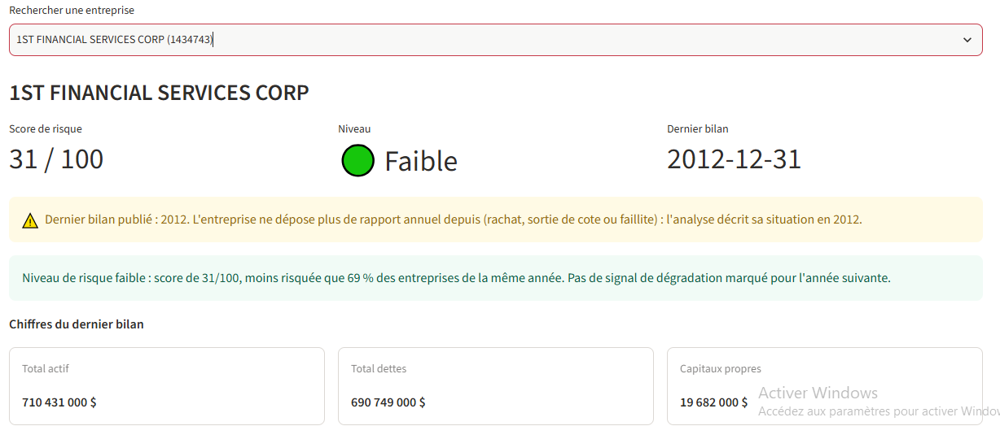
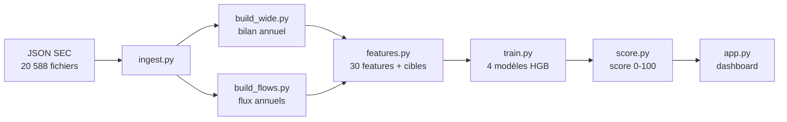

# Alerte précoce sur la santé financière des entreprises cotées


**Prédire, à partir des rapports annuels déposés à la SEC, quelles entreprises vont subir une forte dégradation de leur bilan l'année suivante**, et en tirer un score de risque de 0 à 100 utilisable par un analyste crédit.

Sur des années jamais vues pendant l'entraînement (2022-2024), le modèle détecte les entreprises dont les capitaux propres vont devenir négatifs avec une **AUC de 0,93** : les 10 % d'entreprises qu'il signale concentrent **7 fois plus** de cas que la moyenne.

| | |
|---|---|
| **Données** | SEC EDGAR, rapports annuels 10-K (XBRL, US-GAAP) · 5,4 M valeurs · 14 081 entreprises · 2008-2026 |
| **Modèles** | 4 classifieurs HistGradientBoosting, un par type de dégradation |
| **Validation** | Découpage temporel strict, test 2022-2024 ouvert une seule fois, test automatique anti-fuite |
| **Livrables** | Pipeline reproductible en 1 commande · 17 tests + intégration continue · dashboard Streamlit |



---

## 1. Le problème

Une banque qui reçoit une demande de crédit veut savoir si la situation financière de l'entreprise va **se dégrader**. Prédire le sens d'une petite variation du bilan (+1 % ou −1 %) est presque imprévisible : les modèles plafonnent vers 0,65-0,68 d'AUC, à peine au-dessus d'une règle « même sens que l'an dernier » (65,2 % de bon sens).

Le projet pose donc la question comme le ferait un analyste crédit : **cette entreprise va-t-elle subir l'une de ces quatre dégradations l'année prochaine ?**

| Événement (t → t+1) | Fréquence (test) |
|---|---|
| Les capitaux propres deviennent négatifs | 3,8 % |
| Les capitaux propres perdent plus de 10 % des actifs | 20,0 % |
| Les actifs baissent de plus de 20 % | 14,7 % |
| La trésorerie est divisée par 2 ou plus | 15,2 % |

## 2. Les données

Fichiers *Company Facts* de la SEC (`companyfacts.zip`, un JSON par entreprise) : tous les montants que les entreprises cotées américaines déclarent au format XBRL.

- **Bilan** : 25 postes (actifs, dettes, trésorerie, capitaux propres…) → 3 024 124 valeurs.
- **Compte de résultat et flux de trésorerie** : 13 postes (chiffre d'affaires, résultat net, cash de l'activité…) → 2 397 983 valeurs.
- Rapports **10-K uniquement** (annuels, audités) : horizon de prédiction constant d'un an, pas de saisonnalité.

## 3. Les décisions de nettoyage (toutes justifiées par l'exploration)

| Constat dans les données | Décision |
|---|---|
| Un 10-K contient le bilan de l'année **et** le comparatif N-1 ; 70,3 % des valeurs sont déclarées plusieurs fois, dont 5,8 % avec un montant **corrigé** l'année suivante | Garder la **première valeur publiée** (*point-in-time*) : pas d'information que la banque n'avait pas à l'époque |
| L'écart entre date du bilan et date de dépôt montre **4 pics** (70, 430, 790, 1 150 jours) : seuls les deux premiers viennent du bilan ; dates aberrantes (1927, 2201) | Garder 0 ≤ écart ≤ 550 jours (seuil robuste entre 500 et 700) |
| **1 786 bilans trimestriels** cachés dans des 10-K ; ~20 % des flux sont trimestriels | Garder uniquement les clôtures annuelles et les flux de 350 à 380 jours |
| Total des dettes souvent absent | Reconstruit par l'identité comptable Actifs = Dettes + Capitaux propres (16,2 % des bilans) |
| Négatifs impossibles (dette, trésorerie) ; sociétés coquilles à moins de 1 M$ d'actifs | Négatifs impossibles → NaN ; seuil de 1 M$ d'actifs (86 % des bilans gardés) |
| Fusions et scissions (ex. CIK 833444 : Tyco puis Johnson Controls, 2016), années manquantes | Paires t → t+1 seulement si les deux clôtures sont espacées de 330 à 400 jours |

Résultat : **92 831 bilans annuels de 12 218 entreprises**, dont 79 480 avec une année suivante connue.

## 4. La méthode



- **30 features**, toutes connues à la date du bilan t : ratios de structure (dettes/actifs, capitaux propres/actifs, liquidité générale…), de rentabilité (ROA, marge d'exploitation), de cash (cash de l'activité, investissements, distributions), coût et couverture de la dette, variations t-1 → t.
- **Absence de fuite vérifiée automatiquement** : on recalcule toutes les features après avoir effacé les données postérieures à une date ; elles doivent être identiques (`tests/test_pipeline.py`).
- **Découpage temporel** : entraînement ≤ 2019, validation 2020-2021, test 2022-2024. Tous les choix (features, hyperparamètres, règles de comparaison) ont été figés et committés **avant** d'ouvrir le test.
- **Modèle** : HistGradientBoosting. Comparé sur la validation à la forêt aléatoire, Extra Trees, la régression logistique et un ensemble : meilleur ou à égalité sur 5 cibles sur 6 (écart de 0,002 d'AUC sur la dernière). Le réglage des hyperparamètres n'apporte presque rien : la limite vient du problème, pas de l'algorithme.

## 5. Les résultats (test 2022-2024, années jamais vues)

| Événement | AUC modèle | Meilleure règle simple* | Gain | Lift top 10 % |
|---|---|---|---|---|
| Capitaux propres deviennent négatifs | **0,932** | 0,725 | +0,207 | **× 7,2** |
| Actifs en baisse de plus de 20 % | **0,864** | 0,760 | +0,104 | × 3,4 |
| Perte de capitaux propres > 10 % des actifs | **0,856** | 0,792 | +0,064 | × 3,0 |
| Trésorerie divisée par 2 | **0,709** | 0,524 | +0,185 | × 2,4 |

\* Règle à une seule variable (ex. « capitaux propres / actifs faible »), choisie sur la validation. Les règles simples se dégradent d'une période à l'autre ; le modèle reste stable.

**Variables les plus utiles** : rentabilité des actifs (ROA), capitaux propres / actifs, bénéfices cumulés, cash généré par l'activité, variation passée de la trésorerie. Interaction notable : beaucoup de capitaux propres **et** des pertes = profil biotech / start-up qui brûle son cash.

## 6. Le score de risque

Les 4 probabilités sont converties en **rang parmi les entreprises de la même année**, combinées (poids : capitaux propres négatifs 35 %, perte de capitaux propres 25 %, chute des actifs 25 %, trésorerie 15 %), puis reclassées de 0 à 100. Un score de 95 signifie « plus risquée que 95 % des entreprises de l'année ». Le rang reste fiable quand le niveau général du risque change avec la conjoncture (les probabilités brutes, elles, sont sous-estimées après 2020).

Vérification sur le test 2022-2024, avec les modèles appris sur ≤ 2021 :

| Niveau | Part des entreprises | CP deviennent négatifs | Actifs −20 % | Trésorerie ÷ 2 |
|---|---|---|---|---|
| 🟢 Faible (< 50) | 50 % | 0,3 % | 2,3 % | 9,8 % |
| 🟡 Modéré (50-75) | 25 % | 5,2 % | 19,1 % | 16,1 % |
| 🟠 Élevé (75-90) | 15 % | 13,8 % | 39,4 % | 26,8 % |
| 🔴 Très élevé (≥ 90) | 10 % | 17,8 % | 42,2 % | 31,4 % |

Une entreprise dont les capitaux propres sont **déjà** négatifs reçoit le rang maximal sur cette dimension (le modèle n'a appris que sur des entreprises aux capitaux propres positifs).

## 7. Le dashboard

`streamlit run app/app.py`

- **Analyser un dossier** : importer le JSON SEC d'une entreprise (même absente de la base), voir ses chiffres, lancer l'analyse, télécharger un rapport.
- **Vue d'ensemble** : répartition par niveau et classement des entreprises les plus à risque d'une année.
- **Fiche entreprise** : score, résumé, 4 risques, signaux de fragilité et points forts, évolution du score.
- **Comparer deux entreprises** : laquelle des deux est la moins risquée ?
- **Fiabilité du modèle** : les résultats du test et les limites.

## 8. Reproduire

```bash
git clone https://github.com/Khaoulalim/balance-sheet-scoring.git
cd balance-sheet-scoring
python -m venv .venv && .venv\Scripts\activate        # Windows (Linux/macOS : source .venv/bin/activate)
pip install -r requirements.txt

# Données : https://www.sec.gov/Archives/edgar/daily-index/xbrl/companyfacts.zip (à dézipper)
python run_pipeline.py --src "chemin/vers/companyfacts"   # tout (~1 h, dont l'ingestion)
python run_pipeline.py --from wide                       # sans relancer l'ingestion (quelques minutes)
python -m pytest -q                                       # 17 tests
streamlit run app/app.py
```

Tous les paramètres (seuils, dates de découpage, hyperparamètres, poids) sont dans `src/config.py`. Versions des bibliothèques figées dans `requirements.txt`.

```
├── src/            ingest · build_wide · build_flows · features · events · train · score · predict_one · config
├── app/            dashboard Streamlit (app.py) + calculs testés (logic.py)
├── tests/          17 tests, dont le test anti-fuite, sur données synthétiques
├── notebooks/      exploration et décisions (01 à 08)
├── reports/        résultats du test (metrics_test.csv, score_par_niveau_test.csv)
└── run_pipeline.py pipeline complète
```

## 9. Limites

- **Périmètre** : entreprises cotées américaines (données SEC). Une banque devrait réentraîner le modèle sur ses propres clients.
- **Petites entreprises** (< 100 M$ d'actifs) : plus volatiles, prédictions moins fiables (AUC de 0,61 à 0,83 selon l'événement, en validation).
- **Probabilités sous-estimées** après 2020 (la fréquence des dégradations a augmenté) : le score repose sur le rang pour cette raison.
- **Information partielle** : ni secteur, ni gouvernance, ni conjoncture, ni garanties.
- **Biais du survivant** : les entreprises qui cessent de publier (rachat, faillite) sortent des données.
- Les « signaux de fragilité » du dashboard situent les ratios par rapport aux autres entreprises ; ils ne décomposent pas la prédiction du modèle.

## 10. Pistes d'amélioration

- Explication individuelle de chaque score (SHAP).
- Secteur d'activité (codes SIC de la SEC) et variables macroéconomiques.
- Validation contre de vrais défauts de paiement pour calibrer les poids du score.
- Suivi de la dérive des données (PSI) et réentraînement annuel automatisé.

---

*Projet réalisé dans le cadre du cours Analytics Edge (EMINES - UM6P, 2026).*
**Khaoula LIMAM** - élève ingénieure en Management Industriel, option Data Sciences Industrielles · [LinkedIn](https://www.linkedin.com/in/khaoula-limam-6470a2335)
